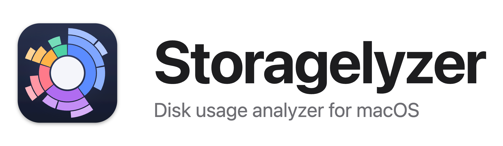
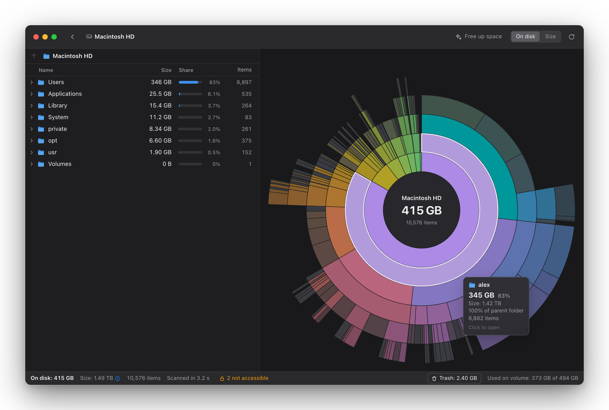
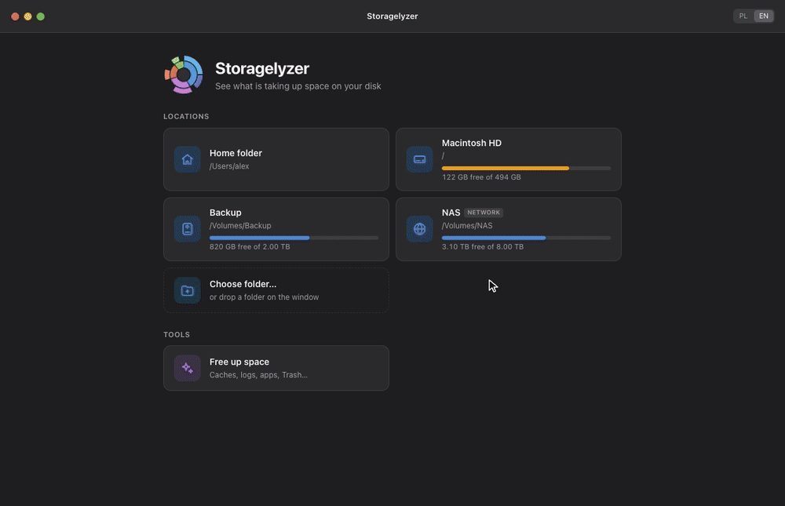
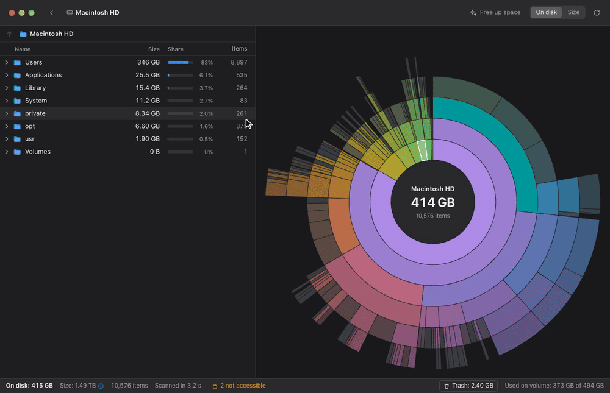

<p align="center">
  <picture>
    <source media="(prefers-color-scheme: dark)" srcset="docs/media/logo-dark.png">
    
  </picture>
</p>

<p align="center">
  <b>See what fills your Mac's disk — and free it up safely.</b><br>
  A fast disk usage analyzer for macOS, inspired by GNOME's Disk Usage Analyzer.
</p>

<p align="center">
  
</p>

## Features

- **Sunburst + tree.** Your disk as rings: hover to see a folder's size, click to dive in, click the centre to go back. The folder list stays in sync with the chart.
- **Fast, live scans.** A Rust scanner built on `getattrlistbulk(2)` reads a whole Mac in seconds, and the chart grows smoothly while it works. Sizes match `du`; hard links count once; APFS firmlinks are not counted twice; iCloud files are never downloaded.
- **Free up space.** Finds what hides behind macOS "System Data": app caches (Chrome, Slack, VS Code and other web apps included), logs, Xcode and simulator data, developer tool caches, old iPhone backups, installers, Time Machine snapshots — plus your biggest apps with when you last opened them, and leftovers of apps you have uninstalled. Not a hard-coded list: app names and "is it still installed?" come from macOS itself, so it works for any app.
- **Safe by default.** Everything goes to the Trash first, only what the analysis found can be removed, and data of installed apps is shown for reference only.
- **Honest sizes.** "On disk" vs "Size" — and when they differ wildly (a 1 TB `Docker.raw` that takes 20 GB, files kept only in iCloud), the app shows exactly which files cause it.
- Light and dark mode, Finder and Quick Look integration, keyboard navigation, English and Polish. The app is about 5 MB.

<table>
  <tr>
    <td width="50%"></td>
    <td width="50%"></td>
  </tr>
  <tr>
    <td align="center">Live scan</td>
    <td align="center">Free up space</td>
  </tr>
</table>

More in the [gallery](docs/media/GALLERY.md).

## Install

Build from source — you need macOS 11+, [Rust](https://rustup.rs), Node.js 20+ and the Xcode Command Line Tools. In a clone of this repository:

```bash
npm install
npm run install-app      # builds Storagelyzer.app and moves it to /Applications
```

Then give it **Full Disk Access** (System Settings → Privacy & Security → Full Disk Access → +). Without it macOS hides Mail, Messages, Safari and other apps' data, so totals come out too low; the app tells you when that happens.

> Builds are ad-hoc signed and macOS ties Full Disk Access to the exact build: after installing a new one, switch the permission off and on again.

## Development

```bash
npm run tauri dev           # the app, with hot reload
npm run dev                 # only the UI, in a browser, on generated demo data
cd src-tauri && cargo test  # scanner, tree, clean-up rules
npm run media               # re-create the screenshots and GIFs (needs Chrome and ffmpeg)
```

| Where | What |
|---|---|
| `src-tauri/src/scan/` | parallel scanner: `getattrlistbulk`, firmlinks, volume boundaries |
| `src-tauri/src/tree.rs` | in-memory tree, ~48 bytes per file, consistent during a scan |
| `src-tauri/src/cleanup.rs` | "Free up space" rules |
| `src-tauri/src/apps.rs` | LaunchServices and Spotlight lookups (app names, last opened) |
| `src/components/RingChart.tsx` | canvas sunburst: zoom, live morphing, hit testing |

Design notes and the reasoning behind the scanner (in Polish): [docs/README.pl.md](docs/README.pl.md).

## License

[MIT](LICENSE)
