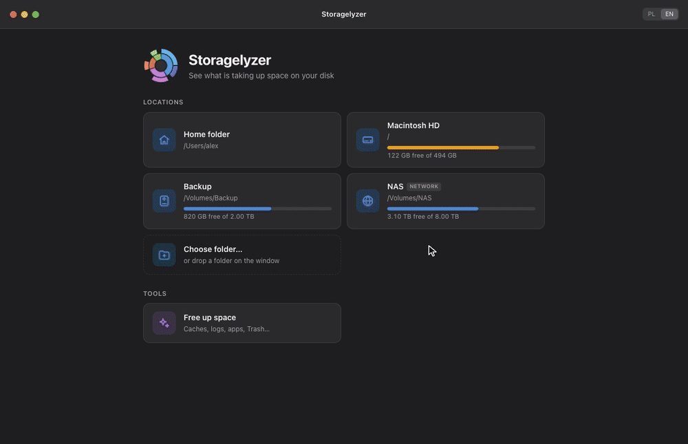
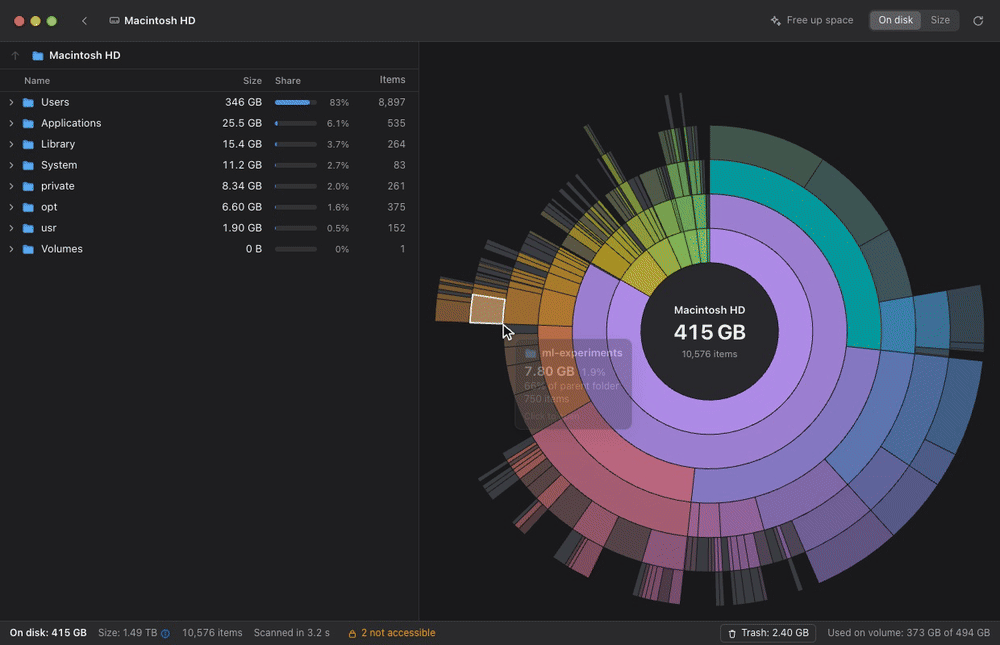
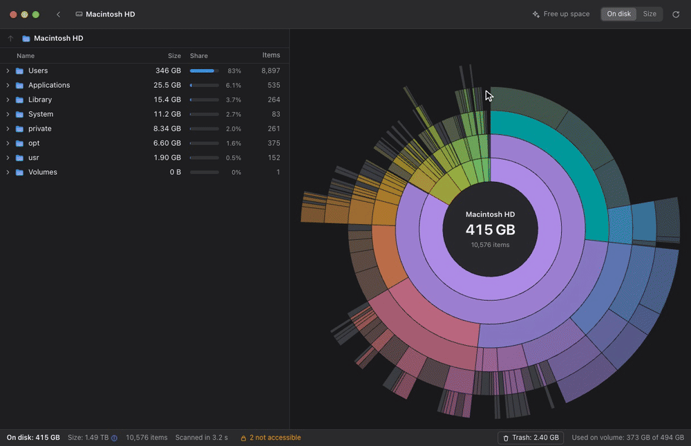
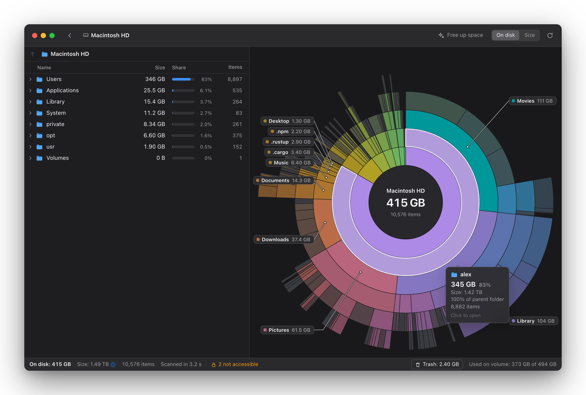
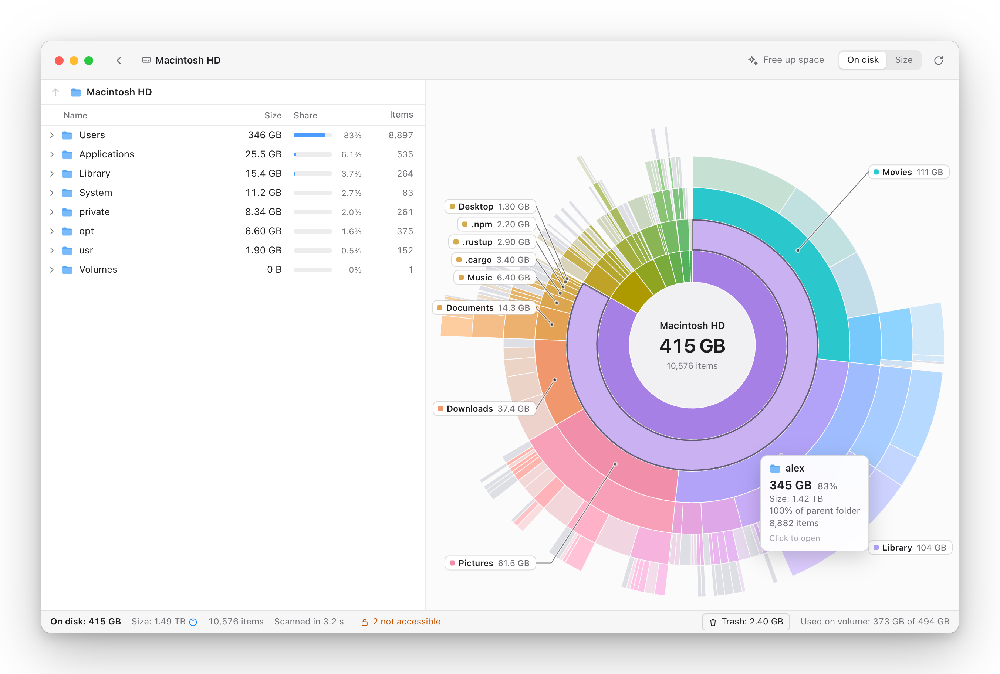
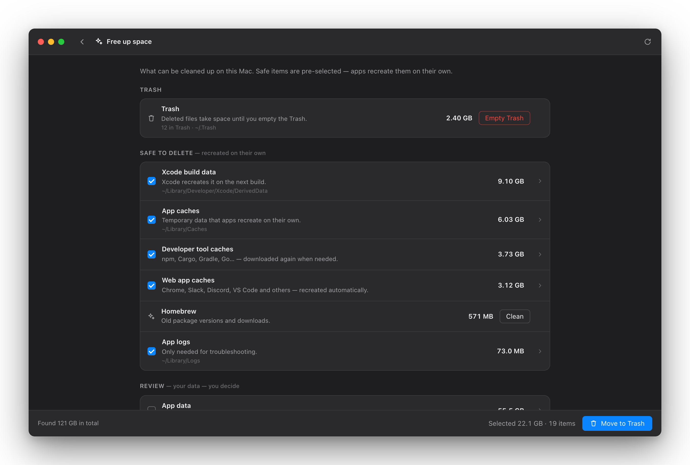
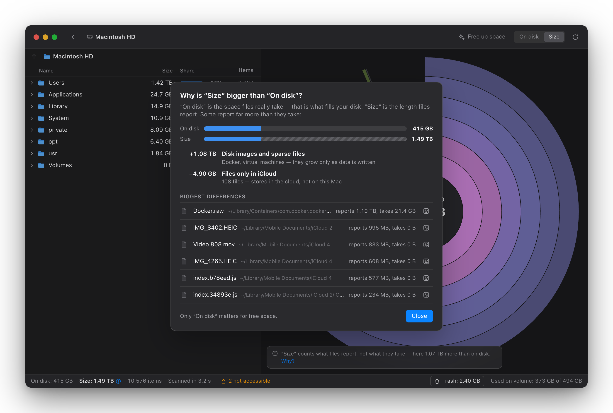
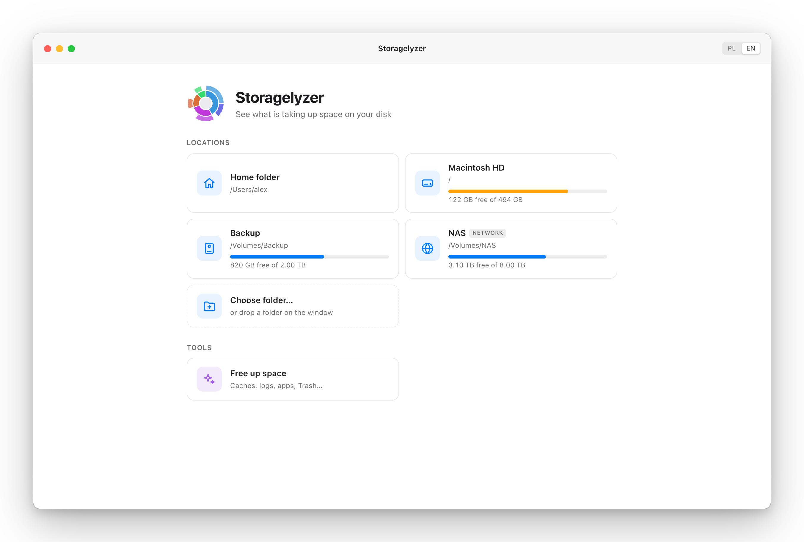
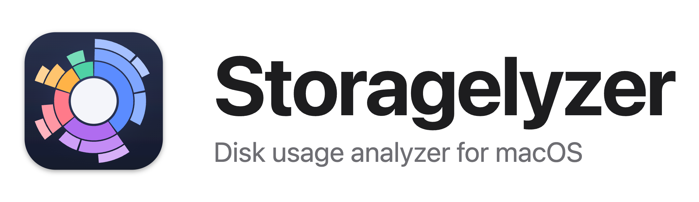

# Gallery

Made from the browser preview on generated demo data — no real files — with `npm run media`.

## GIFs

### Live scan — `scan.gif`

Pick a disk: the sunburst sweeps in and grows smoothly as the scan finds more, instead of jumping between updates. Folders that have not been read yet pulse softly.

### Explore — `explore.gif`

Hover a folder: lines lead to the biggest items inside it, each labelled with its name and size. Click to zoom in, click the centre to go back up.

### Tree and chart in sync — `tree.gif`

Hovering a row in the list highlights its segment. Enter opens the folder in the chart, ⌘↑ goes back.

### "Size" vs "On disk" — `size.gif`

Switch to logical size and the chart morphs to it. "Why?" lists the files that make "Size" bigger than the disk: here a sparse Docker disk image and files kept only in iCloud.

### Free up space — `cleanup.gif`

Categories appear as they are measured; safe ones are pre-selected. Apps show when you last opened them, and data of uninstalled apps is marked and can be removed.

## Screenshots

| | |
|---|---|
|  |  |
| Main window (dark) — `main-dark.png` | Main window (light) — `main-light.png` |
|  |  |
| Free up space — `cleanup.png` | Why "Size" is bigger — `size-explained.png` |
|  |  |
| Start screen — `start.png` | Logo — `logo-light.png`, `logo-dark.png`, `icon.png` |
